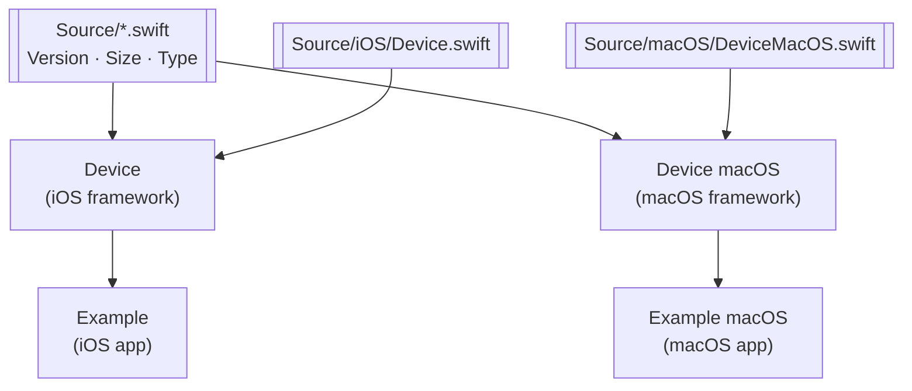

<div align="center">


# 📚 Device

**Detects the device model, type and screen size at runtime · iOS · macOS**

Glovo's fork of [`Ekhoo/Device`](https://github.com/Ekhoo/Device): a small Swift framework with no dependencies. It reads the hardware model identifier and screen metrics and maps them to enums. It is **not** a service: it has no backend, no runtime config and no CI. Glovo's own changes (iPhone 13 and iPhone 14 models) exist only in this repo, so apps must **install it from this Git URL**, not from upstream.

[](Device.podspec)
[](Device.podspec)
[](Device.podspec)
<br/>
[](Device.podspec)
[](Device.xcodeproj/xcshareddata/xcschemes)
[](LICENSE)
[](https://github.com/Ekhoo/Device)

</div>

---

## Table of contents

- [Overview](#overview)
- [Modules](#modules)
- [Build & local development](#build--local-development)
- [Repository layout](#repository-layout)
- [Contributing & conventions](#contributing--conventions)
- [Glossary](#glossary)
- [Ownership & support](#ownership--support)

---

## Overview

Apps often need to adapt layout or behaviour to the hardware they run on. **Device** answers three questions through static methods on the `Device` class: which model is this (`version()`), what kind of device is it (`type()`), and how big is the screen (`size()`). On iOS it reads the **model identifier** from `utsname().machine` (for example `iPhone14,7`) and the screen height in **points** from `UIScreen.main`. On macOS it reads `hw.model` through `sysctlbyname` and the physical size of the main display. Anything it does not recognise returns `.unknown` or `.unknownSize`.

This fork has 7 commits that upstream doesn't have (podspec version bumps, then iPhone 13 and iPhone 14 mappings in PRs #1 and #2). It is also 30 commits behind upstream `master`. Upstream's latest tag is `3.8.0`; this fork's latest is `3.4.0`. Both counts were checked on 2026-10-29. The last Glovo change merged on 2022-09-14.

| | |
|---|---|
| **Language / build** | Swift 5.0 · Xcode project [`Device.xcodeproj`](Device.xcodeproj) · CocoaPods spec [`Device.podspec`](Device.podspec) |
| **Runtime** | iOS 8.0+ (UIKit) · macOS 10.10+ (Cocoa), from the podspec deployment targets |
| **API contract** | `Device` class plus the `Version`, `Size` and `Type` enums in [`Source/`](Source) |
| **Owner** | none declared; see [Ownership & support](#ownership--support) |

### Public API

| Call | Returns | iOS | macOS | Notes |
|---|---|---|---|---|
| `Device.version()` | `Version` on iOS · `String` on macOS | ✅ | ✅ | macOS returns text like `macBookPro 15.0-inch`, not an enum |
| `Device.type()` | `Type` | ✅ | ✅ | iPhone / iPad / iPod / simulator, or the Mac family |
| `Device.size()` | `Size` | ✅ | ✅ | `Size` supports `==`, `<` and `>` |
| `Device.isRetina()` | `Bool` | ✅ | — | `UIScreen.main.scale > 1.0` |
| `Device.isPad()` · `isPhone()` · `isPod()` · `isSimulator()` | `Bool` | ✅ | — | Shortcuts over `type()` |
| `Device.isEqualToScreenSize(_:)` · `isLargerThanScreenSize(_:)` · `isSmallerThanScreenSize(_:)` | `Bool` | ✅ | — | **Deprecated**: use `==`, `>`, `<` instead |

### How detection works

- **iOS model:** `getVersion(code:)` in [`Source/iOS/Device.swift`](Source/iOS/Device.swift) is one `switch` from identifier to [`Version`](Source/Version.swift). `Version` has 72 cases: 38 iPhone, 17 iPad, 8 iPad Pro, 7 iPod, `simulator` and `unknown`.
- **Simulator:** only the identifiers `i386` and `x86_64` map to `.simulator`. Any other identifier (for example `arm64`) gives `.unknown`, and `isSimulator()` returns `false`.
- **iOS size:** `size()` switches on the longer side of `UIScreen.main.bounds`, in points. The heights 667, 812, 896 and 1024 are shared by several screens, so it also checks `UIScreen.main.scale` or `version()`. Any other height returns `.unknownSize`.
- **macOS size:** the diagonal of `NSScreen.main` from `CGDisplayScreenSize`, rounded down to whole inches. 21 maps to `.screen21_5Inch`. The main screen can be an external display.
- **Per-platform enums:** the cases of [`Size`](Source/Size.swift) and [`Type`](Source/Type.swift) sit inside `#if os(iOS)` / `#elseif os(OSX)`. iOS-only cases such as `.screen4Inch` don't exist on macOS, and the reverse is also true.

> [!WARNING]
> The newest mapped model is `iPhone15,3` (`.iPhone14ProMax`). Newer iPhones and iPads return `.unknown` from `version()`, and also `.unknownSize` when their screen height isn't in the `size()` table. Code that switches on these enums needs a `default` branch.

<details><summary><b>Usage: iOS device version</b></summary>

```swift
func myFunc() {
    /*** Display the device version ***/
    switch Device.version() {
        /*** iPhone ***/
        case .iPhone4:       print("It's an iPhone 4")
        case .iPhone4S:      print("It's an iPhone 4S")
        case .iPhone5:       print("It's an iPhone 5")
        case .iPhone5C:      print("It's an iPhone 5C")
        case .iPhone5S:      print("It's an iPhone 5S")
        case .iPhone6:       print("It's an iPhone 6")
        case .iPhone6S:      print("It's an iPhone 6S")
        case .iPhone6Plus:   print("It's an iPhone 6 Plus")
        case .iPhone6SPlus:  print("It's an iPhone 6 S Plus")
        case .iPhoneSE:      print("It's an iPhone SE")
        case .iPhone7:       print("It's an iPhone 7")
        case .iPhone7Plus:   print("It's an iPhone 7 Plus")
        case .iPhone8:       print("It's an iPhone 8")
        case .iPhone8Plus:   print("It's an iPhone 8 Plus")
        case .iPhoneX:       print("It's an iPhone X")
        case .iPhoneXS:      print("It's an iPhone Xs")
        case .iPhoneXS_Max:  print("It's an iPhone Xs Max")
        case .iPhoneXR:      print("It's an iPhone Xr")

        /*** iPad ***/
        case .iPad1:           print("It's an iPad 1")
        case .iPad2:           print("It's an iPad 2")
        case .iPad3:           print("It's an iPad 3")
        case .iPad4:           print("It's an iPad 4")
        case .iPad5:           print("It's an iPad 5")
        case .iPad6:           print("It's an iPad 6")
        case .iPadAir:         print("It's an iPad Air")
        case .iPadAir2:        print("It's an iPad Air 2")
        case .iPadMini:        print("It's an iPad Mini")
        case .iPadMini2:       print("It's an iPad Mini 2")
        case .iPadMini3:       print("It's an iPad Mini 3")
        case .iPadMini4:       print("It's an iPad Mini 4")
        case .iPadPro9_7Inch:  print("It's an iPad Pro 9.7 Inch")
        case .iPadPro10_5Inch: print("It's an iPad Pro 10.5 Inch")
        case .iPadPro12_9Inch: print("It's an iPad Pro 12.9 Inch")

        /*** iPod ***/
        case .iPodTouch1Gen: print("It's a iPod touch generation 1")
        case .iPodTouch2Gen: print("It's a iPod touch generation 2")
        case .iPodTouch3Gen: print("It's a iPod touch generation 3")
        case .iPodTouch4Gen: print("It's a iPod touch generation 4")
        case .iPodTouch5Gen: print("It's a iPod touch generation 5")
        case .iPodTouch6Gen: print("It's a iPod touch generation 6")

        /*** Simulator ***/
        case .simulator:    print("It's a Simulator")

        /*** Unknown ***/
        default:            print("It's an unknown device")
    }
}
```

This list is a sample. [`Source/Version.swift`](Source/Version.swift) has every case, up to `.iPhone14ProMax`.

</details>

<details><summary><b>Usage: iOS screen size and device type</b></summary>

```swift
func myFunc() {
    /*** Display the device screen size ***/
    switch Device.size() {
        case .screen3_5Inch:  print("It's a 3.5 inch screen")
        case .screen4Inch:    print("It's a 4 inch screen")
        case .screen4_7Inch:  print("It's a 4.7 inch screen")
        case .screen5_5Inch:  print("It's a 5.5 inch screen")
        case .screen5_8Inch:  print("It's a 5.8 inch screen")
        case .screen6_1Inch:  print("It's a 6.1 inch screen")
        case .screen6_5Inch:  print("It's a 6.5 inch screen")
        case .screen7_9Inch:  print("It's a 7.9 inch screen")
        case .screen9_7Inch:  print("It's a 9.7 inch screen")
        case .screen10_5Inch: print("It's a 10.5 inch screen")
        case .screen12_9Inch: print("It's a 12.9 inch screen")
        default:              print("Unknown size")
    }
}
```

```swift
func myFunc() {
    /*** Display the device type ***/
    switch Device.type() {
        case .iPod:         print("It's an iPod")
        case .iPhone:       print("It's an iPhone")
        case .iPad:         print("It's an iPad")
        case .simulator:    print("It's a Simulated device")
        default:            print("Unknown device type")
    }
}
```

or

```swift
func myFunc() {
    /*** Display the device type ***/
    if Device.isPad() {
        print("It's an iPad")
    } else if Device.isPhone() {
        print("It's an iPhone")
    } else if Device.isPod() {
        print("It's an iPod")
    } else if Device.isSimulator() {
        print("It's a Simulated device")
    }
}
```

</details>

<details><summary><b>Usage: Mac type and screen size</b></summary>

```swift
func myFunc() {
    /*** Display the mac version ***/
    switch Device.type() {
        case .iMac:         print("It's an iMac")
        case .macBook:      print("It's a MacBook")
        case .macBookAir:   print("It's a MacBook Air")
        case .macBookPro:   print("It's a MacBook Pro")
        default:            print("Unknown device type")
    }
}
```

```swift
func myFunc() {
    /*** Display the mac screen size ***/
    switch Device.size() {
        case .screen11Inch:     print("It's a 11 inch screen")
        case .screen12Inch:     print("It's a 12 inch screen")
        case .screen13Inch:     print("It's a 13 inch screen")
        case .screen15Inch:     print("It's a 15 inch screen")
        case .screen17Inch:     print("It's a 17 inch screen")
        case .screen21_5Inch:   print("It's a 21.5 inch screen")
        case .screen27Inch:     print("It's a 27 inch screen")
        default:                print("Unknown size")
    }
}
```

</details>

<details><summary><b>Usage: helpers (size comparison, Retina)</b></summary>

iOS:

```swift
func myFunc() {
    if Device.size() == Size.screen4Inch {
        print("It's a 4 inch screen")
    }
    if Device.size() > Size.screen4_7Inch {
        print("Your device screen is larger than 4.7 inch")
    }
    if Device.size() < Size.screen4_7Inch {
        print("Your device screen is smaller than 4.7 inch")
    }
    if Device.isRetina() {
        print("It's a retina display")
    }
}
```

macOS:

```swift
func myFunc() {
    if Device.size() == Size.screen27Inch {
        print("It's a 27 inch screen")
    }
    if Device.size() > Size.screen15Inch {
        print("Your mac screen is larger than 15 inch")
    }
    if Device.size() < Size.screen15Inch {
        print("Your mac screen is smaller than 15 inch")
    }
}
```

</details>

---

## Modules



| Module | Convention plugin / build type | Main class or artifact | Notes |
|---|---|---|---|
| `Device` | Xcode framework target, iOS 8.0, shared scheme | `Device.framework` (`Device` in [`Source/iOS/Device.swift`](Source/iOS/Device.swift)) | Umbrella header and `Info.plist` in [`Device/`](Device) |
| `Device macOS` | Xcode framework target, macOS 10.10, shared scheme | `Device.framework` (`Device` in [`Source/macOS/DeviceMacOS.swift`](Source/macOS/DeviceMacOS.swift)) | Umbrella header and `Info.plist` in [`Device macOS/`](<Device macOS>) |
| `Example` | Xcode iOS app target | `Example.app` | Depends on and embeds `Device`; [`Example/ViewController.swift`](Example/ViewController.swift) prints what it detects |
| `Example macOS` | Xcode macOS app target, macOS 10.11 | `Example macOS.app` | Depends on and embeds `Device macOS` |
| `Device.podspec` | CocoaPods spec | pod `Device` 3.4.0 | `Source/*.swift` for both platforms, plus `Source/iOS/*.swift` or `Source/macOS/*.swift` |

**Layout gotcha:** both framework targets produce a module named `Device`, so apps always write `import Device`. The podspec picks up files by glob, but the Xcode targets list files one by one. A new Swift file must be added to both framework targets by hand, or Carthage builds will miss it.

---

## Build & local development

> [!NOTE]
> **Prerequisites:** full Xcode with Swift 5 (the Command Line Tools alone can't build the project). Install CocoaPods or Carthage only to test integration into an app. No credentials are needed; the repo is public.

```bash
git clone https://github.com/Glovo/Device.git && cd Device
open Device.xcodeproj                                                            # run the Example or Example macOS target
xcodebuild -project Device.xcodeproj -scheme Device -sdk iphonesimulator build   # iOS framework (shared scheme)
xcodebuild -project Device.xcodeproj -scheme "Device macOS" build                # macOS framework (shared scheme)
```

### Run locally

Run the `Example` target on an iOS device or simulator, or `Example macOS` on a Mac. Each prints the detected version, size and type to the Xcode console.

### Use it in an app

> [!WARNING]
> [`Device.podspec`](Device.podspec) still points `s.homepage` and `s.source` at `Ekhoo/Device`. Upstream's tag `3.4.0` is a **different commit** from this repo's `3.4.0`. Plain `pod 'Device'` or `github "Ekhoo/Device"` installs upstream's code, not this fork.

**CocoaPods.** Add this line to your Podfile:

```ruby
pod 'Device', :git => 'https://github.com/Glovo/Device.git', :tag => '3.4.0'
```

**Carthage.** [Carthage](https://github.com/Carthage/Carthage) is a decentralized dependency manager that builds your dependencies and gives you binary frameworks. Install it with [Homebrew](http://brew.sh/):

```bash
brew update
brew install carthage
```

To add Device to your Xcode project with Carthage, put it in your `Cartfile`:

```ogdl
github "Glovo/Device" == 3.4.0
```

Run `carthage update` to build the framework, then drag the built `Device.framework` into your Xcode project.

---

## Repository layout

```text
.
├── Source/                        ⭐ library code; the only code that ships
│   ├── Version.swift              # Version enum: every known iPhone / iPad / iPod model
│   ├── Size.swift                 # Size enum and its ==, < operators
│   ├── Type.swift                 # Type enum: iOS device kinds and Mac families
│   ├── iOS/Device.swift           # iOS implementation: identifier → Version, points → Size
│   ├── macOS/DeviceMacOS.swift    # macOS implementation: hw.model, display diagonal
│   └── Asset/device.png           # logo used at the top of this README
├── Device/                        # iOS framework target: umbrella header + Info.plist
├── Device macOS/                  # macOS framework target: umbrella header + Info.plist
├── Example/                       # iOS demo app
├── Example macOS/                 # macOS demo app
├── Device.xcodeproj/              # Xcode project; shared schemes Device and Device macOS
├── Device.podspec                 # CocoaPods spec (version 3.4.0)
└── LICENSE                        # MIT
```

`build/`, `DerivedData`, `xcuserdata` and `Carthage/Build` are git-ignored ([`.gitignore`](.gitignore)).

---

## Contributing & conventions

1. **Add a new model** the way PR #2 did: add the case to [`Source/Version.swift`](Source/Version.swift), map its identifier(s) in `getVersion(code:)`, and add the screen height to `size()` if it's new. Both functions are in [`Source/iOS/Device.swift`](Source/iOS/Device.swift).
2. **Bump `s.version`** in [`Device.podspec`](Device.podspec) in the same PR. Then tag the merge commit with that version: tags `3.3.0` and `3.4.0` point at the merge commits of PRs #1 and #2. Apps pin to these tags.
3. **Keep platform-specific cases** inside the existing `#if os(iOS)` / `#elseif os(OSX)` blocks in `Size.swift` and `Type.swift`.
4. **New source files** go in `Source/`, `Source/iOS/` or `Source/macOS/`, and must be added to the matching Xcode framework target(s) (see [Modules](#modules)).
5. **No tests and no CI.** Check a change by running the `Example` / `Example macOS` apps.
6. **Check upstream first:** upstream [`Ekhoo/Device`](https://github.com/Ekhoo/Device) may already have the mapping you need, since this fork is 30 commits behind it.
7. Commit subjects are plain English with no ticket prefix. Glovo changes went through PRs to `master` from `minor/<change>` branches.

There is no `CODEOWNERS` file, so GitHub doesn't request a review from any team.

---

## Glossary

| Term | Meaning |
|---|---|
| **Model identifier** | Apple's hardware code, such as `iPhone14,7` or `iPad13,1`. It comes from `utsname().machine` on iOS and `hw.model` on macOS, and `version()` maps it to an enum case |
| **Point** | iOS logical screen unit. `size()` switches on the screen height in points, not pixels |
| **Podspec** | The CocoaPods spec file ([`Device.podspec`](Device.podspec)) that declares the version, sources and deployment targets |
| **CocoaPods trunk** | The public pod registry. A plain `pod 'Device'` resolves there, which is not this fork |
| **Carthage** | A dependency manager that builds frameworks from a repo's shared Xcode schemes |

---

## Ownership & support

- **Team:** none declared. The repo has no `CODEOWNERS` file and no `catalog-info.yaml`.
- **Glovo changes:** PR #1 (iPhone 13 models, merged 2021-09-27) and PR #2 (iPhone 14 models, merged 2022-09-14).
- **Upstream author:** Lucas Ortis, me@lucas-ortis.com · [@LucasEkhoo](https://twitter.com/LucasEkhoo) · [LinkedIn](https://fr.linkedin.com/in/lucasortis). Upstream repo: [`Ekhoo/Device`](https://github.com/Ekhoo/Device).
- **License:** MIT. See [`LICENSE`](LICENSE).
